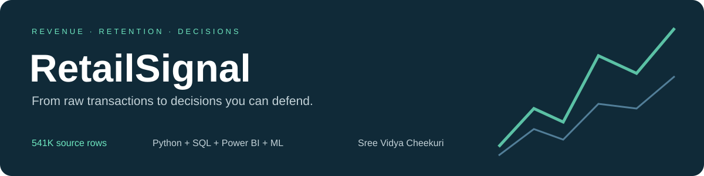
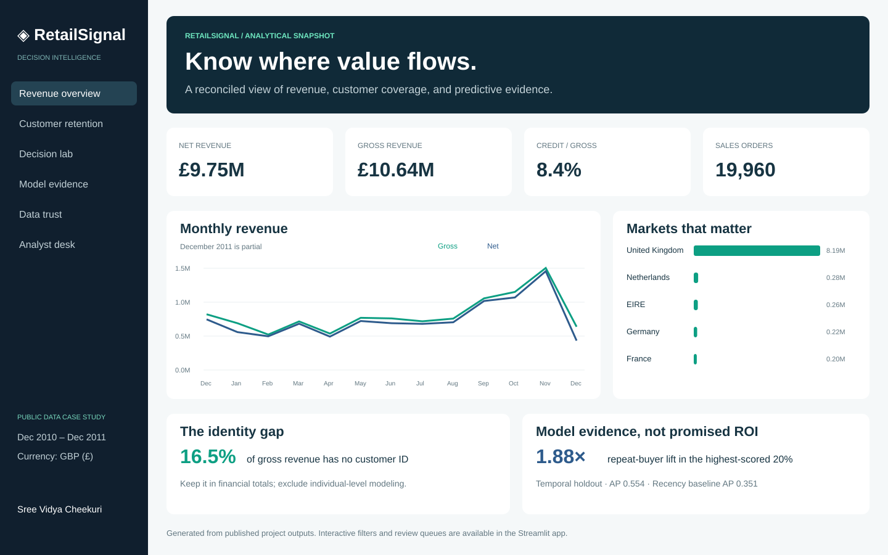
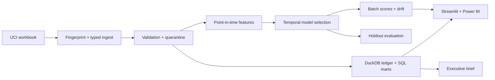

<p align="center"></p>

<p align="center">
  <a href="https://github.com/vidyacheekuri/retailsignal/actions"></a>
  
  
  
</p>

**A complete retail analytics project that turns 541,909 real transaction lines into trusted revenue reporting, customer retention analysis, and a capacity-aware customer review queue.**

Historical portfolio case study using public data.

[Business findings](reports/executive_brief.md) · [Architecture](docs/architecture.md) · [Model card](docs/model_card.md) · [Power BI setup](powerbi/README.md)

## The business problem

A retail operations team needs a consistent answer to three questions:

1. **Where is revenue going?** Reconcile sales and credits without dropping anonymous purchases.
2. **Which customers return?** Compare acquisition cohorts without confusing unobserved months with zero retention.
3. **Whom should analysts review first?** Rank repeat-purchase propensity within a fixed capacity, and separate predictions from assumptions about campaign impact.

The deliverable is a decision system: an auditable Python/SQL pipeline, a local warehouse, six dashboard workspaces, temporal ML evaluation, batch scoring, drift diagnostics, and an editable Power BI project.

## Explore the dashboard



*Portable analytical snapshot; launch the app for interactive filtering and customer review.*

| Workspace | What it demonstrates |
|---|---|
| Revenue overview | Country/date filters, revenue bridge, trend analysis, identity coverage, CSV export |
| Customer retention | Censored cohort heatmap and explainable behavior segments |
| Decision lab | Capacity-aware shortlist, downloadable scores, explicit campaign assumptions |
| Model evidence | Baselines, temporal splits, AP, lift, calibration, permutation importance, drift |
| Data trust | Quarantine policy, source fingerprint, row and financial reconciliation |
| Analyst desk | Reproducible business answers with supporting tables and an executive brief |

**Try it locally without downloading the raw data.** Small, real-data-derived marts and evaluation artifacts are included in Git. No API key or paid service is required.

```bash
git clone https://github.com/vidyacheekuri/retailsignal.git
cd retailsignal
python3.13 -m venv .venv
source .venv/bin/activate
# Windows PowerShell: .venv\Scripts\Activate.ps1
python -m pip install -r requirements-lock.txt
python -m pip install -e . --no-deps
python -m streamlit run app.py
```

Open the local URL printed by Streamlit. Python 3.13 is the tested environment. `pip install -e '.[dev]'` is an alternative if you prefer resolving compatible versions rather than the exact tested lockfile.

## Results, with evidence

| Metric | Measured result | Evidence |
|---|---:|---|
| Source / accepted / quarantined rows | 541,909 / 534,129 / 7,780 | [Quality report](reports/data_quality.json) |
| Net recorded revenue | £9,748,131.07 | [SQL mart](data/exports/mart_monthly.csv) |
| Gross revenue without customer ID | 16.5% | [Executive brief](reports/executive_brief.md) |
| Selected model | Logistic regression | [Evaluation](reports/model_evaluation.json) |
| Holdout average precision | 0.554 vs 0.351 recency baseline | [Model comparison](data/exports/model_metrics.csv) |
| Precision in top 20% | 58.1% | [Held-out predictions](data/exports/test_predictions.csv) |
| Repeat buyers captured in top 20% | 37.7%; 1.88× random lift | [Evaluation](reports/model_evaluation.json) |
| Latest historical scoring population | 3,477 customers | [Customer scores](data/exports/customer_scores.csv) |

**These are historical analysis and predictive results, not realized revenue lift.** The model predicts natural repeat purchase; it does not estimate who will respond incrementally to an offer. Campaign economics in the dashboard are scenarios. See the [model card](docs/model_card.md) for uncertainty and limitations.

## Rebuild everything from source

```bash
python -m retailsignal.cli build
python -m pytest -q
```

The build downloads the 22.6 MB UCI workbook if absent, fingerprints it, validates records, builds the DuckDB warehouse, exports marts, selects a model using validation data, evaluates a later holdout, scores a final snapshot, and writes the executive brief. The first workbook read is cached by SHA-256. Subsequent builds replace tables and exports rather than appending duplicate data.

Raw workbook, quarantine, warehouse, and executable model artifacts stay local and are excluded from Git. Rebuild runtime varies by machine; approximately 38 seconds was observed locally for the first successful run, excluding download and environment setup.

```bash
# Score a feature CSV using the locally rebuilt, trusted model artifact:
python -m retailsignal.cli score \
  --input data/exports/customer_scores.csv \
  --output rescored_customers.csv
```

Only load joblib artifacts you trust. The scoring contract validates required columns, finite/non-negative values, and order-count consistency. See [data contracts](docs/data_dictionary.md).

## Architecture



## Power BI

Open `powerbi/RetailSignal.pbip` in Windows Power BI Desktop. Set the **DataFolder** parameter to this repository's `data/exports` directory, then refresh. The package contains **3 pages, 16 visuals, 13 DAX measures, 5 model tables, and 2 relationships**. The date and country dimensions filter the daily revenue fact; cohorts and customer snapshots intentionally use separate grains.

**Validation boundary:** 23 report JSON files passed Microsoft's published schemas and automated field-binding checks pass. Desktop refresh, DAX execution, and rendering have not been verified on this macOS build host. The Streamlit dashboard is the fully executed and tested interactive deliverable. [Setup and validation checklist →](powerbi/README.md)

## Engineering practices

- Money reconciles in integer pennies; the small sub-penny rounding effect is disclosed.
- Anonymous sales remain in financial totals; customer modeling requires an ID.
- Credits remain negative ledger events; original-order matches are not invented.
- Training features end strictly before each scoring date; label windows are complete.
- Model selection uses validation AP; the holdout is reserved for reporting.
- Cohort missing periods and observed zero-retention periods are distinguished.
- CI runs cleaning, leakage, SQL, artifact, Power BI binding, and dashboard interaction tests.
- Optional manual CI rebuild downloads the source and publishes rebuilt evidence as a workflow artifact.

## Repository map

```text
app.py                    Six-workspace interactive dashboard
src/retailsignal/          Ingest, features, modeling, monitoring, insights, CLI
sql/                      Warehouse transformations + analysis queries
powerbi/                  Editable PBIP report, semantic model, DAX, theme
notebooks/                Guided exploratory analysis
scripts/                  Reproducible Power BI generation
reports/                  Quality, evaluation, executive brief, validation evidence
data/exports/             Small, versioned analysis and scoring outputs
tests/                    Unit, integration, artifact, and dashboard tests
docs/                     Requirements, contracts, and model card
```

## Run and share

- **Local:** use the quick start above.
- **Container:** `docker build -t retailsignal .` then `docker run --rm -p 8501:8501 retailsignal`. The container configuration is supplied but was not executed on the build host.
- **Streamlit Community Cloud:** deploy this repository with entrypoint `app.py` and Python 3.13. Deployment is optional and not claimed as completed.

## Data attribution and licenses

Chen, D. (2015). **Online Retail** [Dataset]. UCI Machine Learning Repository. [DOI: 10.24432/C5BW33](https://doi.org/10.24432/C5BW33). Data is licensed [CC BY 4.0](https://creativecommons.org/licenses/by/4.0/). This project cleans, aggregates, and models that data; the exported data and derived evidence retain this attribution. See [DATA_LICENSE.md](DATA_LICENSE.md).

Original project code: [MIT](LICENSE). No private employer data, resume, personal contact information, or credentials are included.
